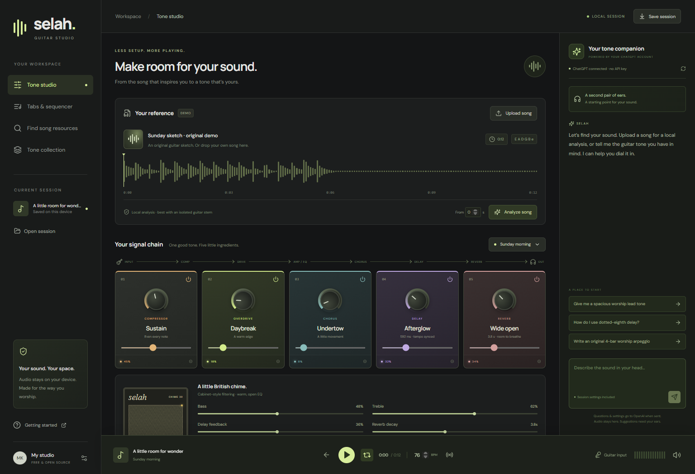

# Selah — GuitarSim AI

A free, open-source guitar workstation for praise and worship practice: a playable effects rack, local reference audio, editable guitar tabs, a shared step sequencer, and an assistant using **your ChatGPT account through the official Codex CLI, without an API key**.



## Get the Windows app

Download **Selah-windows-x64.zip** from [Releases](https://github.com/MAYKELL07/GuitarSimAI/releases), extract the entire folder, and open **Selah.exe**. The portable app includes its runtime; Node.js is only needed separately if you install the Codex CLI for AI features. The release is unsigned.

The app and all audio tools are free. AI features require an eligible ChatGPT/Codex account and use that account’s access and usage limits. A ChatGPT subscription is not included or sold by this project. No OpenAI API key, paid audio plugin, or paid tab subscription is required by the app.

## Run from source

Install Node.js **22.12 or newer** and Git, then:

```sh
git clone https://github.com/MAYKELL07/GuitarSimAI.git
cd GuitarSimAI
npm ci
npm run dev
```

Open **http://127.0.0.1:5173**. For the production browser version:

```sh
npm run build
npm start
```

Open **http://127.0.0.1:5174**. To run the desktop shell from source, build first and use `npm run desktop`. To package Windows x64, use `npm run package:win`.

## Connect ChatGPT without an API key

```sh
npm install -g @openai/codex
codex login
codex login status
```

Complete the official browser sign-in yourself. Then select **Refresh assistant connection** in Selah. Use a current Codex CLI supporting `exec`, `--ignore-user-config`, `--ephemeral`, `--output-schema`, and live `--search`. An existing ChatGPT sign-in can be reused; Selah never reads, copies, exports, or publishes your login credentials.

This is an account-backed **Codex companion**, not an embedded ChatGPT website and not this chat’s conversation history. Recent messages are sent as context within the current app session. AI-key environment variables are removed from the child process and ChatGPT authentication is required. If the CLI is not on PATH, set `CODEX_BIN` to the full path to its native executable.

Official references: [ChatGPT/Codex authentication](https://learn.chatgpt.com/docs/auth) and [non-interactive runs and structured output](https://learn.chatgpt.com/docs/non-interactive-mode). Eligibility and limits are controlled by OpenAI.

## What you can do

- **Upload reference audio.** Decode browser-supported WAV, MP3, FLAC, M4A, or OGG files locally, up to 150 MB. Seek in the waveform and mix the dry reference with the processed guitar part. Uncheck Loop to hear the entire recording.
- **Analyze a passage.** Choose a starting second and analyze up to 90 seconds in a Web Worker. Get a tempo estimate, possible key, and an editable monophonic melody draft. Load the draft into both tabs and the sequencer.
- **Shape your guitar tone.** Compression, soft-clipped drive, cabinet-style high/low filtering, bass/treble EQ, modulated chorus, tempo-synced delay, feedback, and convolution reverb. Bypass pedals individually. Four worship-oriented starting presets are included.
- **Play real guitar.** Connect an audio interface, use headphones, enable Guitar input, and grant audio input permission. Disable input to choose a different device. Input is processed through the same rack as the synthesized guitar.
- **Write a part.** Six strings in standard tuning, up to 128 bars of 4/4, a 16-step grid per bar, editable frets and note lengths, looped playback, tempo control, metronome, and a deterministic plucked-string synth.
- **Ask your companion.** Request a tone and explicitly apply its proposed settings. Request an **original 4-bar practice arrangement** and load the proposed notes directly into the tab editor and sequencer.
- **Find free song resources.** Enter the song, artist, and optional live/acoustic/release version. AI performs a live web search; a separate checker fetches the returned page to inspect identity and access. Open the original chart or tab at its source.
- **Export.** Text guitar tabs, standard MIDI (including tempo), processed guitar-sequence WAV, or a portable JSON session. Session settings are autosaved in the current browser/app profile. Reference audio is kept separately and must be reopened after a restart.

The included “Sunday sketch” is a synthesized original demo, not a commercial recording.

## What verification means

Resource cards distinguish **source identity** from **musical accuracy**:

| Check | What it establishes |
| --- | --- |
| Song title | Requested title appears in the page’s title or main heading. |
| Artist | Artist text appears on the fetched page. |
| Version | Requested version text appears on the page; otherwise unconfirmed. |
| Access | Explicit free-access wording, an identified access restriction, or unconfirmed. |
| Accuracy | Always unverified against the actual recording unless you compare it yourself. |

The AI’s source description is shown separately from independent page checks. Search favors free sources; access can change. Blocked, redirected, non-HTML, or unavailable pages are not presented as verified. Chord charts are distinguished from lead tabs and official resources from user submissions in the source description. Complete third-party charts are not scraped into the app. Open the source, follow its terms, and arrange/review your own part in the shared editor.

**A matching page is not proof that its notes or timing are correct.** The app cannot certify an exact arrangement from a link alone, and an original AI exercise is not a transcription of that song.

## Honest audio limitations

An arbitrary mastered recording does not reveal a uniquely recoverable pedalboard. Selah offers useful editable starting points, not an exact amp/pedal model recovery system. Its “Suggest starting tone” button uses simple measured level/brightness to choose a stylistic preset; delay and reverb are defaults, not measured effect parameters.

Pitchy detects a **single predominant pitch**. In a full mix, vocals or bass may dominate. It does not isolate guitar, transcribe polyphonic chords, or recover all instruments. Guitar-only stems work best. Tempo can be half or double the intended tempo; key estimation can be ambiguous. Review frets, note lengths, key, and tempo by ear. Load a draft, then adjust BPM and edit the shared arrangement. WAV exports contain the synthesized guitar arrangement with effects, excluding reference audio and live input.

Live input latency depends on your interface, OS, and browser. This is not an ASIO host, VST host, commercial amp profiler, or a replacement for a production DAW. Hardware monitoring has to be checked on your actual audio interface.

## Privacy and local service

Audio decode, pitch analysis, effects, sequencing, and rendering happen locally. Questions, session metadata, recent companion messages, and analysis summaries are sent to OpenAI only when you request an AI action; **audio samples are not sent**. Web search sends the song/artist/version query, and source verification visits returned public HTTPS pages. Fonts may load from Google Fonts; fallback system fonts work offline.

The assistant service binds to `127.0.0.1`, checks Host and Origin, rejects cross-site requests, limits request sizes, uses structured responses, runs Codex in a temporary read-only workspace with shell tools disabled, and ignores the user’s Codex project configuration for those runs. Keep it local; this service is not designed for public hosting. The public GitHub repository contains source and app binaries, not songs, credentials, or private sessions.

## Development and checks

```sh
npm test
npm run build
npm audit
```

Tests cover known-pitch transcription, silence, synthetic tempo, fingering, malformed session rejection, MIDI/tab exports, source identity/access distinctions, URL restrictions, and local-service request boundaries. Browser verification exercises playback signal, uploads, analysis, shared note editing, WAV/MIDI/tab downloads, session restore, and responsive layouts. Live ChatGPT tone, source-search, and original-arrangement requests were also exercised during development. See [VALIDATION.md](VALIDATION.md) for the delivered build’s validation record.

## Technology and license

React, TypeScript, Vite, Electron, Web Audio, [Pitchy](https://github.com/ianprime0509/pitchy) (0BSD), and Lucide (ISC). No proprietary audio assets or song recordings are bundled. This project is released under the [MIT license](LICENSE). Dependencies retain their respective licenses.
